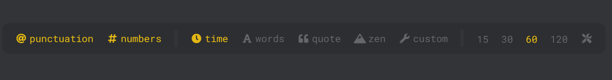
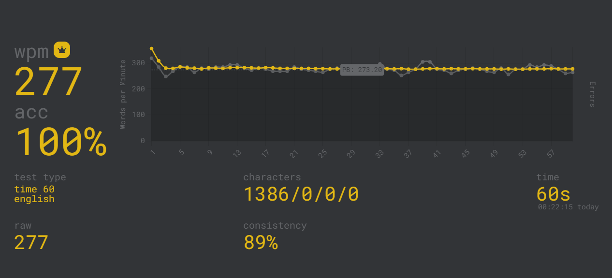

# MonkeyType-BOT

A browser-automation learning project. The script uses `Selenium` to read the words on the [MonkeyType](https://monkeytype.com/) typing page and `PyAutoGUI` to type them, then records WPM, accuracy and consistency for each typing-delay setting.

- Reads the active word and its letters from the page DOM with Selenium.
- Types each letter with PyAutoGUI at a delay you choose.
- Works with every typing `mode` and `time` setting.
- Collects WPM, accuracy and consistency after each run and prints them as a table, so you can compare delay settings.

### Setup

1. Install [ChromeDriver](https://chromedriver.chromium.org/downloads) and add it to your PATH. If that doesn't work, put your `chromedriver.exe` path in `monkeytype.py`.
2. Clone this repository.
3. Run `pip install -r requirements.txt`.
4. Run `monkeytype.py`.

### How it works

1. The script opens [monkeytype.com](https://monkeytype.com/) and accepts the cookie banner.
2. It asks for your MonkeyType username and password and logs in.
3. It asks for the delay between keystrokes in seconds (for example 0.1).
4. You choose the typing `mode` and `time`, then press OK.
5. It types the test, reads the results from the page, and asks if you want to run again.

### Screenshots

### Disclaimer

This project is for learning browser automation only. Don't use it to submit scores to public leaderboards. Automated scores go against MonkeyType's fair-play rules.
